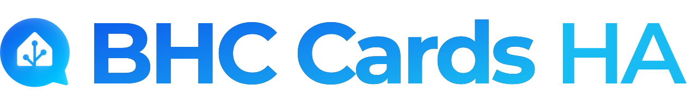
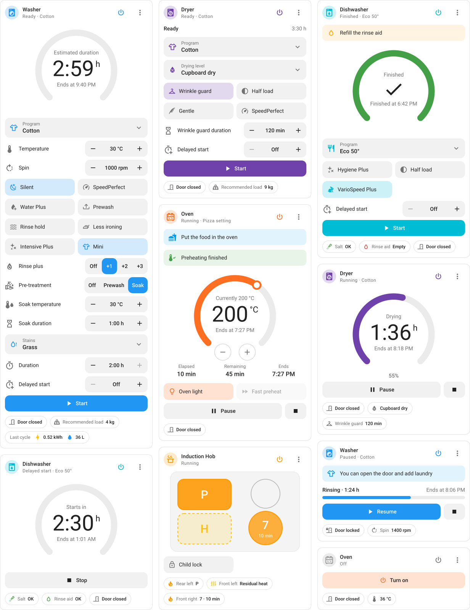
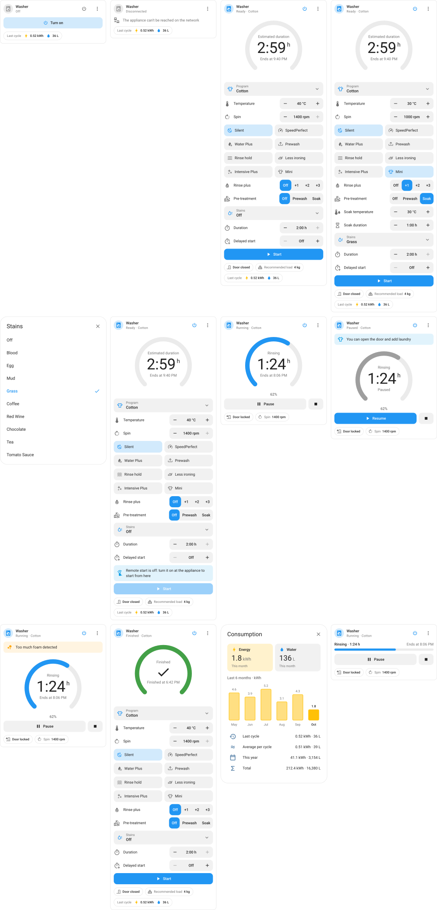
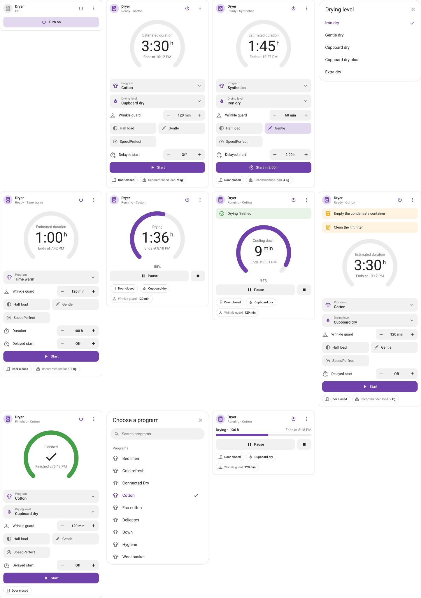
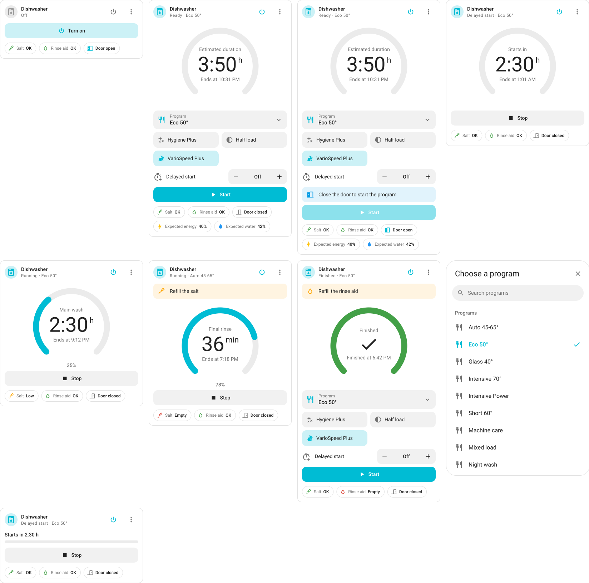
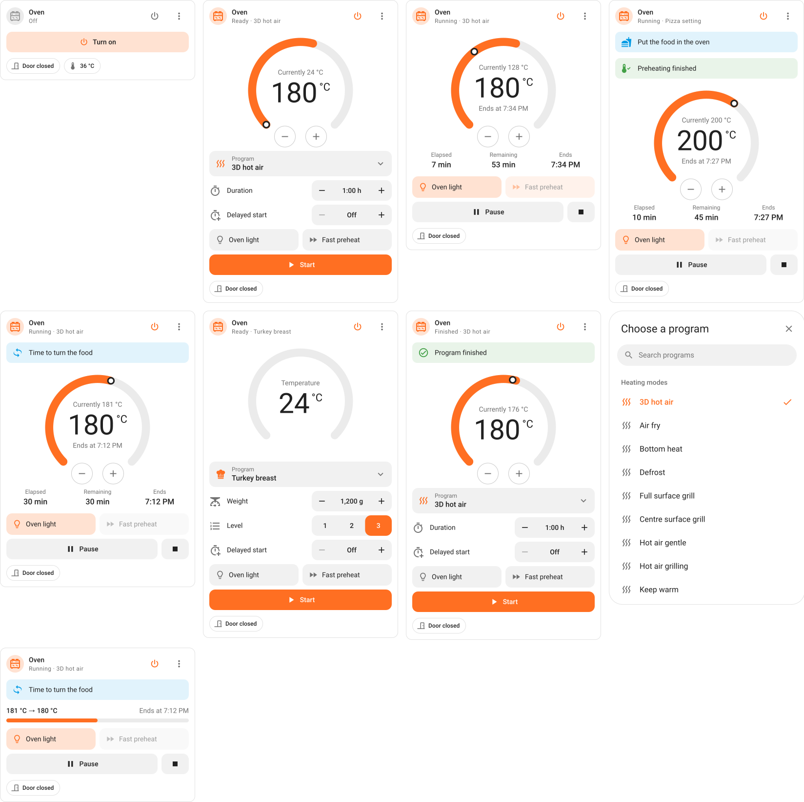
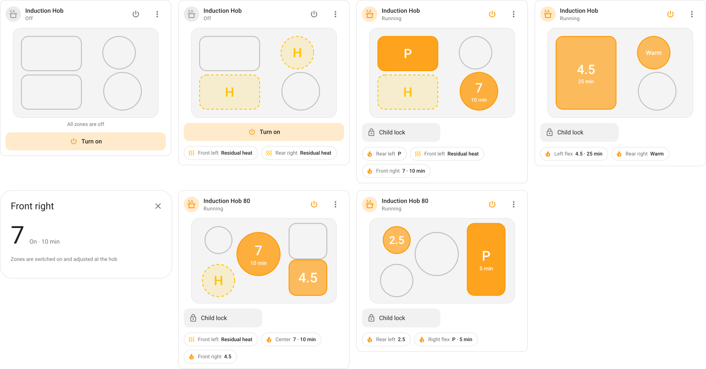

<p align="center">
  
</p>

<p align="center">
  <strong>Home Assistant cards for Bosch and Siemens appliances,<br>
  with live status, program picker and controls.</strong>
</p>

<p align="center">
  <a href="https://github.com/fabioscarparo/bosch-homeconnect-cards/releases/latest"></a>
  <a href="https://hacs.xyz/"></a>
  <a href="https://www.home-assistant.io/"></a>
  <a href="https://developer.mozilla.org/docs/Web/JavaScript"></a>
  <a href="LICENSE"></a>
</p>

Lovelace cards for **Bosch** and **Siemens** appliances connected through
[Home Connect Local](https://github.com/chris-mc1/homeconnect_local_hass),
the integration that talks to the appliances directly on your network.

There is one card for each type of appliance:

- **Washer** - program, temperature, spin speed and options, remaining
  time, and the energy and water of the last cycle and month by month
- **Dryer** - program, drying level, wrinkle guard and options, remaining
  time and phase, condensate and lint filter reminders
- **Dishwasher** - program and options, delayed start, salt and rinse aid
- **Oven** - heating mode, temperature, duration, automatic recipes and
  cooking hints such as "time to turn the food"
- **Induction hob** - a live map of the cooking zones with power level,
  timer and residual heat, flex zones included

Pick the appliance and the card does the rest: **no entity ids to type**,
and renamed entities keep working.

<picture>
  <source media="(prefers-color-scheme: dark)" srcset="images/wall-dark.svg">
  
</picture>

---

## Installation

### Requirements

- **Home Assistant 2024.8** or later, with [HACS](https://hacs.xyz)
  installed
- The **Home Connect Local** integration (`homeconnect_ws`), with your
  appliances already set up: either the original by
  [chris-mc1](https://github.com/chris-mc1/homeconnect_local_hass) or the
  fork by [vemboy200](https://github.com/vemboy200/homeconnect_local_hass),
  see [Compatibility](#compatibility)

> [!IMPORTANT]
> The cards work with Home Connect Local only. The official Home Connect
> integration of Home Assistant creates different entities, so the cards
> can't find them.

### Install with HACS

The cards are not in the default HACS store: add them as a custom
repository.

1. Open **HACS**, then **⋮ → Custom repositories**.
2. Add `https://github.com/fabioscarparo/bosch-homeconnect-cards` with
   type **Dashboard**.
3. Search for **Bosch Home Connect Cards**, open it and select
   **Download**. HACS adds the dashboard resource for you and lets you know
   when a new version is out.
4. Reload the browser.

### Manual installation

1. Copy `bosch-homeconnect-cards.js` into the `www/bosch-homeconnect-cards/`
   folder of your Home Assistant configuration.
2. Go to **Settings → Dashboards → ⋮ → Resources → Add resource**, enter
   `/local/bosch-homeconnect-cards/bosch-homeconnect-cards.js` and choose
   **JavaScript module**. The **Resources** menu shows up with **Advanced
   mode** turned on in your user profile.
3. Reload the browser.

## Adding a card

1. Open a dashboard and select **Edit dashboard** (pencil).
2. Select **Add card** and search for **Home Connect**: you find
   **Home Connect Washer**, **Dryer**, **Dishwasher**, **Oven** and
   **Induction hob**.
3. Pick the appliance in the visual editor and save. The editor
   preselects the first appliance of the right type.

### If the card shows an error

Right after installing or updating the cards, the companion app can keep
showing the frontend from its cache: the cards are missing from the
picker, or the dashboard shows an error such as *Custom element doesn't
exist: homeconnect-washer-card*. Reset the app's frontend cache, then
reopen the app:

- **Android:** **Settings → Companion app → Troubleshooting → Reset
  frontend cache**
- **iOS:** **Settings → Companion app → Debugging → Clear web view cache**

In a browser, a hard reload is enough: **Ctrl+Shift+R**, or
**Cmd+Shift+R** on macOS.

### Configuration

```yaml
type: custom:homeconnect-washer-card
device_id: 0123456789abcdef0123456789abcdef
name: Washer               # optional: defaults to the device name
icon: mdi:washing-machine  # optional
color: blue                # optional: a Home Assistant color name or any CSS color
hide_hero: false           # optional: compact view, without the dial
```

| Card | Type | Default color |
|---|---|---|
| Washer | `custom:homeconnect-washer-card` | `blue` |
| Dryer | `custom:homeconnect-dryer-card` | `deep-purple` |
| Dishwasher | `custom:homeconnect-dishwasher-card` | `cyan` |
| Oven | `custom:homeconnect-oven-card` | `deep-orange` |
| Induction hob | `custom:homeconnect-hob-card` | `orange` |

The compact view (`hide_hero`) is not available on the hob card, where the
map of the zones is the card itself.

### Finding the `device_id`

The visual editor fills it in for you. For YAML, go to **Developer tools →
Template** and paste:

```jinja

{{ device_attr(d, 'name') }}: {{ d }}

```

It prints one line per appliance:

```text
Washer: 8c1f5e2a9b7d4e3f6a0b1c2d3e4f5a6b
Oven: 4f1c9e0a7b2d4c3e8a6f5b1d2c3e4f50
```

In a browser you can also open the device page: the ID is the last part of
the address, after `/config/devices/device/`.

## The cards

### Washer

The dial shows the remaining time, the progress and the current phase of
the program. Before starting you set up the program like in the Home
Connect app: temperature, spin speed, options such as **SpeedPerfect**,
**Silent** or **Mini**, extra rinses, pre-treatment and soak, stain
treatment and duration, each one only when the program allows it. The card
also shows the recommended load. While the program runs you can pause it,
resume it or stop it, and the card tells you when laundry can still be
added.

The **Last cycle** badge shows the energy and water of the last program.
Tap it, or the **Consumption** badge when there's no last cycle, to see the
energy and water of this month, a chart of the last six months, the date
of the last cycle, the average per cycle, this year and the total, from the
Home Assistant statistics.

<picture>
  <source media="(prefers-color-scheme: dark)" srcset="images/washer-dark.svg">
  
</picture>

### Dryer

The same dial as the washer, with the phase of the program: drying,
cooling down, wrinkle guard. Before starting you choose the program, the
**drying level** from iron dry to extra dry, the **wrinkle guard** and how
long it lasts, options such as **Gentle**, **Half load** and
**SpeedPerfect**, the duration of the time programs and the delayed start.
While it runs, the drying level and the wrinkle guard stay in sight. The
card reminds you to empty the condensate container, clean the lint filter
and refill the refresher.

The energy of the last cycle and the consumption sheet show up only on
dryers that report their energy: the Bosch WRB247C0IT behind these images
doesn't.

Programs downloaded from the Home Connect app, such as Jeans, have a code
that Home Connect Local doesn't know yet
([vemboy200/homeconnect_local_hass#230](https://github.com/vemboy200/homeconnect_local_hass/issues/230)):
when one is chosen in the app, the card shows **Program chosen in the app**
with its estimated time, but can't start it.

<picture>
  <source media="(prefers-color-scheme: dark)" srcset="images/dryer-dark.svg">
  
</picture>

### Dishwasher

Same dial as the washer, plus **delayed start**: set the delay, and the
start button turns into **Start in 2:30 h**. Salt and rinse aid are always
in sight, with an alert when they run out.

<picture>
  <source media="(prefers-color-scheme: dark)" srcset="images/dishwasher-dark.svg">
  
</picture>

### Oven

The dial works like the thermostat card: the arc is the target
temperature, the dot is the current one, and the minus and plus buttons
change it in steps of 5 °C. The program list is grouped into heating modes, automatic
programs, recommended dishes and cleaning, with a search field. Controls
follow the program: weight and level for automatic recipes, pyrolysis
level for cleaning, duration and delayed start for heating modes.

<picture>
  <source media="(prefers-color-scheme: dark)" srcset="images/oven-dark.svg">
  
</picture>

### Induction hob

A map of the hob with every cooking zone: power level, timer and residual
heat at a glance, and the **flex zone** drawn as one surface when it is in
use. 80 and 90 cm hobs with a large zone in the middle, such as the Bosch
PXV875DV1E and the Neff T69YYV4C0, get their own map. Select a zone to see its details. Zones are
switched on and adjusted at the hob itself: no version of Home Connect
Local can control them.

<picture>
  <source media="(prefers-color-scheme: dark)" srcset="images/hob-dark.svg">
  
</picture>

## Compatibility

The cards work with both versions of Home Connect Local, and adapt to what
each one provides. The two versions name some entities differently, and
the fork by vemboy200 reports states in lower case, shares one entity name
across the hob zones and handles delayed start on its own: the cards take
care of all of it, also after migrating from one to the other.

| | chris-mc1 (1.0.6) | vemboy200 fork (1.9, 2.0 beta) |
|---|---|---|
| Washer, dryer, dishwasher, oven, hob status | Yes | Yes |
| Programs, options, start, pause, stop | Yes | Yes |
| Delayed start | "Start in" number, started through `homeconnect_ws.start_program` | "Delay start" select in 1.9, number in minutes from 2.0.0b1, applied by the Start button |
| Washer temperature, spin speed, extra rinse, stains, recommended load | Yes | Yes |
| Washer Mini, pre-treatment and soak | No | From 2.0.0b1 |
| Dryer drying level, wrinkle guard, condensate and lint filter | Yes | Yes |
| Energy and water of the last cycle | No | From 2.0.0b1 |
| Consumption by month | No | From 2.0.0b1 |
| Oven light | No | Yes |
| Oven hints and weight | No | From 2.0.0b1 |
| Hob zone control | No | No |

## Optional features

Some parts of the cards appear only when the integration provides the
entities they need. A few of those entities start disabled: Home Assistant
asks integrations to disable by default what few people need, to keep the
device pages tidy and the database small.

| Feature | Entities | Disabled by default |
|---|---|---|
| Energy and water of the last cycle | Last program energy and water consumption | No |
| Consumption by month | Total energy and water consumption, recorded in the Home Assistant statistics | No |
| Date of the last cycle | Start count, on the vemboy200 fork | Yes |
| Average per cycle | Completed count | Yes |
| Oven hints such as "time to turn the food" | The oven event sensors | No |
| Foam alert on the washer | Foam detection | Yes, on new installs of the vemboy200 fork from 2.0.0b1 |
| Drying finished, cool-down and more dryer cleaning reminders | The dryer events proposed to the vemboy200 fork in [#229](https://github.com/vemboy200/homeconnect_local_hass/pull/229) | No |
| Hint when remote control is off | Remote control active, on the vemboy200 fork | Yes |
| Hint when the appliance is in use from its own controls | Local control active, on the vemboy200 fork | Yes |
| Hint when remote start is off | Remote start allowed | With chris-mc1 |

### Enabling a disabled entity

1. Go to **Settings → Devices & services → Home Connect Local** and open
   the appliance.
2. In the **Diagnostic** section, show the entities that are hidden.
3. Select the entity, open its settings with the gear icon, turn on
   **Enabled** and select **Update**.
4. Wait about 30 seconds: Home Assistant reloads the integration, and the
   entity shows as unavailable until then.

Statistics only start when the entity is enabled: the average per cycle,
for example, counts the cycles from then on.

> [!TIP]
> Bosch and Siemens appliances accept a remote start only after you turn on
> **Remote Start** at the appliance itself. The card can tell you so only
> through the **Remote start allowed** entity, which Home Connect Local by
> chris-mc1 disables by default: enable it as described above. Without it,
> when the appliance doesn't accept a start the card disables **Start** and
> suggests what to check.

## Language support

| Language | Supported |
|---|---|
| English | ✅ |
| Italian | ✅ |
| German | ✅ |

Labels, states, program names and the visual editor follow the language of
each user's profile, with English for any other language. Program names ship
with the cards, because the integration doesn't translate all of them. A few
texts come from the integration as they are, such as the phase of a wash, and
follow its own translations.

### Help translate

The texts of the cards are in the [translations](translations) folder, one
file per language:

- **A new language**: copy [`en.json`](translations/en.json) and translate
  the values, leaving the keys as they are.
- **A fix**: change the file of your language.

Keep the words in braces, such as `{t}` or `{n}`: the card fills them in.
For programs and options, use the names the Home Connect app shows in your
language. Then send the file with the
[Translation form](https://github.com/fabioscarparo/bosch-homeconnect-cards/issues/new?template=translation.yml),
or open a pull request.

## How it works

The cards are a single JavaScript file, with no build step and no
dependencies.

### Entities found by device

The cards never ask for entity ids. They read the entity registry, keep the
entities of the selected appliance and recognize each one by its
translation key. Renamed entities keep working, and entities left behind by
older versions of the integration are ignored.

### Actions

Every control calls a standard Home Assistant action, so what happens is
easy to follow in the logbook and in automations:

| Control | Action |
|---|---|
| Program, levels, washer temperature and spin speed, drying level and wrinkle guard | `select.select_option` |
| Oven temperature, duration, weight | `number.set_value`, sent after a short pause so repeated taps add up |
| Delayed start | `select.select_option` or `number.set_value` on the vemboy200 fork. With chris-mc1, `number.set_value` and then `homeconnect_ws.start_program` to start |
| Options, power, oven light | `switch.toggle`, or `light.toggle` when the light is a light entity |
| Start, pause, resume, stop | `button.press` |

## Contributing

### A card for another appliance

Cards for washer-dryers, coffee makers, fridges or hoods are
welcome, but they can't be built without data from a real appliance. If you
own one, three things are enough to get it started:

- **The diagnostics of the appliance**: they describe every feature the
  appliance has, with its programs, options and allowed values
- **The list of its entities and their states**, captured with the script
  below at a few moments: off, ready with a program selected, while a
  program runs and when it has finished
- **What you'd like to see and do from the card**: the information you
  check most and the controls you use every day. Screenshots of the
  official Home Connect app are welcome too

Then open an issue with the
[New appliance card](https://github.com/fabioscarparo/bosch-homeconnect-cards/issues/new?template=new_appliance.yml)
form and attach the files.

> [!WARNING]
> Never attach the ZIP file of the Home Connect Profile Downloader: it
> contains the encryption keys of your appliances.

### Downloading the diagnostics

Go to **Settings → Devices & services → Home Connect Local**, open the
appliance, then **⋮ → Download diagnostics**. Home Assistant removes the
encryption keys, the MAC address and the serial number from the file.

### Capturing entities and states

1. Some entities of the appliance are disabled by default. To include them,
   open the device page, select **+N entities not shown**, then enable them
   and wait a minute.
2. Open Home Assistant in a browser on a computer and open the console:
   **Cmd+Option+J** on macOS, **Ctrl+Shift+J** on Windows and Linux.
   Chrome may ask you to type `allow pasting` first.
3. Paste this script and press **Enter**:

   ```js
   (async () => {
     const hass = document.querySelector("home-assistant").hass;
     // Which integration: the original by chris-mc1 or the vemboy200 fork, and its version
     const manifest = await hass
       .callWS({ type: "manifest/get", integration: "homeconnect_ws" })
       .catch(() => null);
     const appliances = {};
     for (const entry of Object.values(hass.entities)) {
       if (entry.platform !== "homeconnect_ws") continue;
       const device = hass.devices[entry.device_id] || {};
       const stateObj = hass.states[entry.entity_id];
       const { friendly_name, ...attributes } = stateObj?.attributes || {};
       const appliance = (appliances[entry.device_id] ||= {
         model: device.model,
         model_id: device.model_id,
         manufacturer: device.manufacturer,
         entities: [],
       });
       appliance.entities.push({
         domain: entry.entity_id.split(".")[0],
         key: entry.translation_key,
         category: entry.entity_category ?? null,
         state: stateObj?.state ?? null,
         attributes,
       });
     }
     const data = {
       ha_version: hass.config.version,
       integration: manifest && {
         version: manifest.version,
         documentation: manifest.documentation,
         codeowners: manifest.codeowners,
       },
       captured_at: new Date().toISOString(),
       appliances: Object.values(appliances),
     };
     const link = document.createElement("a");
     link.href = URL.createObjectURL(new Blob([JSON.stringify(data, null, 1)], { type: "application/json" }));
     link.download = `homeconnect-entities-${Date.now()}.json`;
     link.click();
     return `${data.appliances.length} appliances exported`;
   })();
   ```

4. The browser downloads a `homeconnect-entities-….json` file. Repeat at
   each moment you want to capture: every run creates a new file.

The file says which integration and version you use. For each entity it
holds its domain, key, category, state and attributes. Entity names and ids,
rooms and device ids are left out.

## Disclaimer

This is a community project, not affiliated with or endorsed by BSH
Hausgeräte GmbH, Bosch or Siemens. Home Connect is a trademark of BSH.

## License

MIT, see [LICENSE](LICENSE).
